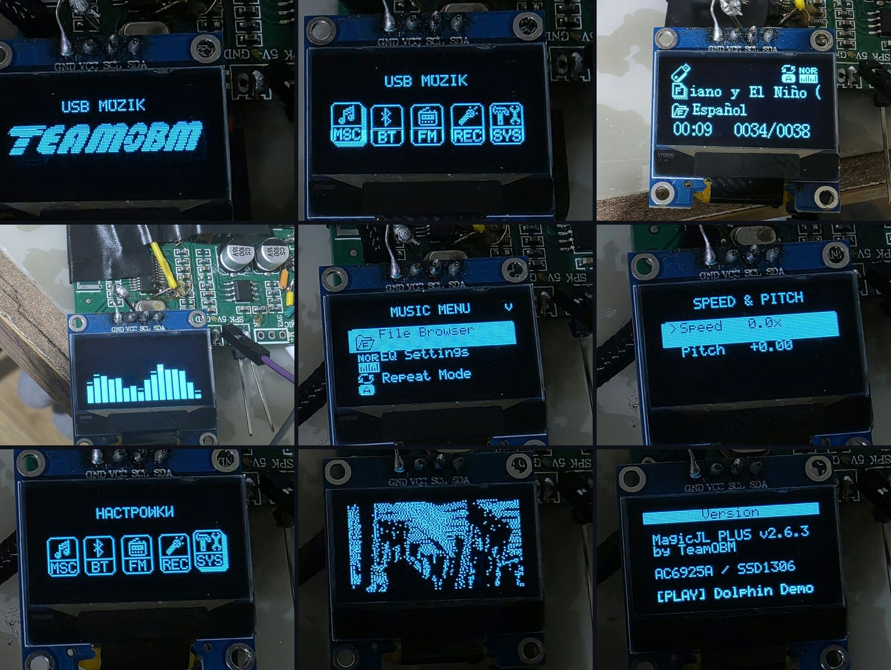
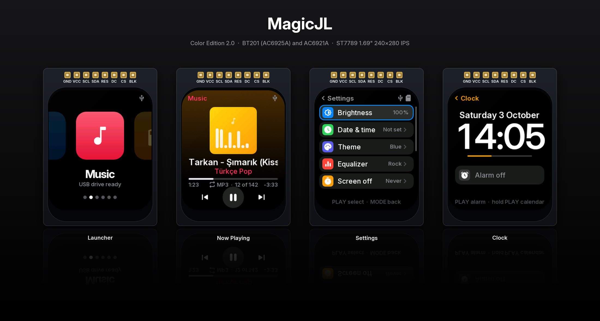

<h1 align="center">Barbaros A.Y. · <code>barbaror4</code></h1>

<p align="center">
  <b>Embedded firmware · Reverse engineering · Audio SoCs · PCB design</b>
  <br>
  <sub>Türkiye · building at <a href="https://github.com/OmfoBalkanMicroElectronics">@OmfoBalkanMicroElectronics</a></sub>
  <br><br>
  
  
  
  
  
</p>

```console
barbaror4@bench:~$ whoami
Firmware developer who takes cheap, undocumented chips apart
and makes them do things their datasheets never promised.
```

I work on embedded systems from the bare metal up: reading datasheets, dumping firmware, tracing undocumented SDKs, and designing the boards to run it all on. My main focus is **JieLi audio SoCs**, plus STM32 and other low-cost platforms that deserve more attention than they get.

---

## 🔧 ./projects

### [MagicJieLi (MagicJL)](https://github.com/OmfoBalkanMicroElectronics/MagicJieLi) · *main project*

Custom firmware and hardware for the **JieLi AC6925** (AC692x), a Bluetooth audio SoC with 128 KB of RAM and 512 KB of flash that normally runs cheap speakers. MagicJL turns it into a full media player, one generation at a time:

| Generation | Display | What it brought |
|---|---|---|
| **MagicJL** v1.0 · [released](https://github.com/OmfoBalkanMicroElectronics/MagicJieLi/releases) | 128×64 I²C OLED | Fixed-point 256-point FFT spectrum analyzer (no FPU), AVRCP now-playing, Arduino Nano boot dongle, verified flash backup & restore |
| **MagicJL Plus** · *tested on AC6925A* | 128×64 SSD1306 OLED | External SPI-flash font pack with **37 UI languages** (CJK, Arabic, Hebrew, Thai, Vietnamese), app launcher with background play, DS3231 clock & calendar, text reader with on-screen keyboard, favourites, custom 5-band EQ, one-file USB update for firmware + fonts, crash reporter. Full firmware & details at https://usmi.mybb.ru/viewtopic.php?id=88 |
| **MagicJL Color 2.0** · *in development, not yet on hardware* | 1.69" ST7789 240×280 IPS | Full-colour animated GUI on a frame-buffer-less strip renderer with SPI DMA, spring physics and anti-aliased Inter type; FM, Bluetooth calls, USB/SD music, alarm clock; a PC simulator and **MagicJL Studio** (an interactive Windows simulator of the whole board); also builds for a bare AC6921A with a PCM5102A I²S DAC |

<p align="center">
  
  <br>
  <sub>MagicJL Plus on real hardware (BT201, AC6925A, SSD1306 OLED)</sub>
</p>

<p align="center">
  
  <br>
  <sub>MagicJL Color 2.0, rendered by the PC simulator from the firmware's own GUI code</sub>
</p>

Custom boards for the platform:

<p align="center">
  
  &nbsp;
  
  <br>
  <sub>MagicJL UNO (Arduino UNO–sized dev board) · MagicJL PLUS board (AC6921A8 + SH1106 SPI OLED, the hardware target for MagicJL Plus)</sub>
</p>

### MAGICEMU · *repository temporarily private*

Retro gaming and multimedia on the **STM32F746G-DISCO**: NES emulation, **DOOM** and **Wolfenstein 3D**, an MP3/FLAC player with FFT, Motion-JPEG video and exFAT support on a Cortex-M7.

> The repository is private for now while its third-party licensing (bundled libraries, fonts and assets) is being cleaned up. It will be public again once that's done.

### [linux-stm32f7-disco](https://github.com/Barbaror4/linux-stm32f7-disco)

**Linux 2.6.33 (uClinux / NOMMU)** running on the STM32F746G-DISCO, with an SD-card root filesystem, USB-HID keyboard host and Ethernet. Real Linux on a microcontroller with no MMU.

## 🤝 ./contributing

### [SoundVisualizer](https://github.com/CaYatur/SoundVisualizer) · [my fork](https://github.com/Barbaror4/SoundVisualizer)

Open-source, cross-platform music visualizer and VJ tool (Electron + WebGL, MilkDrop engine, GPU effects, OBS overlay, RGB lighting).

- **Professional OSC output for show control** ([PR #733](https://github.com/CaYatur/SoundVisualizer/pull/733), *merged*): lets lighting desks, Resolume, TouchDesigner, MadMapper and Millumin lock to the music. It sends a beat clock (BPM, beat and bar phase, downbeat, timetagged bundles, latency offset), level and band meters, kick/snare/hat hits, 16 spectrum bands and the full show state.
- **Stereo Trails** visualizer mode ([PR #732](https://github.com/CaYatur/SoundVisualizer/pull/732), *merged*): a particle fountain where each frequency band launches from its place in the stereo image. Per-band biquad filters measure pan and stereo spread in about 0.07 ms per frame, covered by 16 new tests that caught all 10 deliberately injected bugs.
- **Floating picture-in-picture output window**, proposed and prototyped in [PR #592](https://github.com/CaYatur/SoundVisualizer/pull/592) and now part of the app
- Reverse-engineered Pioneer's **`.lkd` OEL animation format** (gzip → tar → stacked BMP strip), verified against 83 real files

---

## 🧩 ./hardware

<p align="center">
  
  &nbsp;&nbsp;
  
  &nbsp;&nbsp;
  
  &nbsp;&nbsp;
  
</p>

- **JieLi:** AC692x firmware, SDK internals, custom boards
- **STM32:** F103 · F411 · F746
- **Espressif:** ESP32 · ESP8266
- **Displays:** SSD1306 OLED · ST7920 · ST7789 IPS
- **Others:** NationalChip / GuoXin, Generalplus, PIC, AVR

## 🎧 ./interests

```text
├── JieLi AC692x firmware & SDK development
├── Reverse engineering undocumented SoCs and firmware
├── Embedded audio: USB Audio, codecs, DACs, FFT, parametric EQ
├── Embedded GUIs: frame-buffer-less rendering, SPI DMA displays, PC simulators
├── STM32 peripherals, DMA and real-time systems
├── Embedded Linux on NOMMU targets
└── Custom PCB design
```

## 🛠️ ./tools

| Category | Tools |
|---|---|
| **IDEs** | STM32CubeIDE · VS Code · Code::Blocks |
| **Hardware** | Multimeter · CH341A programmer · USB-UART adapters |
| **Debugging** | UART logging · firmware dumps · software diagnostics |

## 💭 ./philosophy

I use the hardware I have and learn from datasheets, source code, experiments and a lot of reverse engineering.

> **Expensive ≠ Interesting**<br>
> **Old ≠ Useless**<br>
> **Cheap ≠ Simple**

<p align="center">
  <b>Understand it. Modify it. Push it further.</b>
  <br><br>
  
  <br><br>
  <i>Hardware is more fun when you dig deeper.</i>
</p>
