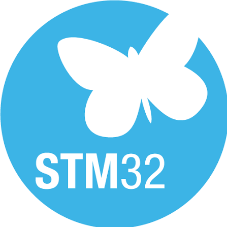

BARBAROR4 

 <b>Embedded Systems • Firmware • Reverse Engineering • Audio DSP</b>        

barbaror4@bench:~$ whoami Electronics enthusiast focused on embedded systems, firmware analysis, low-level development and audio. I like understanding how things work — and finding out what more can be done with the hardware I have. ./hardware 

           

\

Working with STM32F103, F411 and F746, alongside ESP32/ESP8266. Particularly interested in JieLi audio SoCs, obscure consumer electronics chips and undocumented firmware.

./interests Embedded audio, USB Audio & DSP STM32 peripherals, DMA and real-time systems Firmware analysis & reverse engineering JieLi SDKs and obscure SoCs Audio codecs, DACs, FFT & parametric EQ Reusing old and inexpensive hardware ./projects 

MagicEMU:
https://github.com/Barbaror4/MAGICEMU
MagicEMU is an advanced retro emulation and multimedia platform built for the STM32F746G-DISCO discovery board (ARM Cortex-M7 @ 216 MHz, 8 MB external SDRAM, 480x272 LTDC display, WM8994 audio codec, MicroSD over 4-bit SDMMC).

Linux-stm32f7-disco:
https://github.com/Barbaror4/linux-stm32f7-disco

A working Linux 2.6.33 (uClinux / NOMMU) port for the low-cost STMicroelectronics STM32F746G-DISCO board — a 216 MHz Cortex-M7 with only 8 MB of external SDRAM and no MMU. 

./tools 

\

IDEs: Code::Blocks, STM32CubeIDE, VS Code
Hardware: Multimeter, CH341A, USB-UART adapters
Debugging: UART logs, firmware dumps, software diagnostics

./philosophy 

I don't have an expensive lab setup — no oscilloscope or logic analyzer. I work with what I have, using datasheets, source code, software tools and plenty of experimentation.

Expensive != Interesting Old != Useless Cheap != Simple Understand it. Modify it. Push it further. 

        <i>Hardware is more fun when you dig deeper.</i> 

