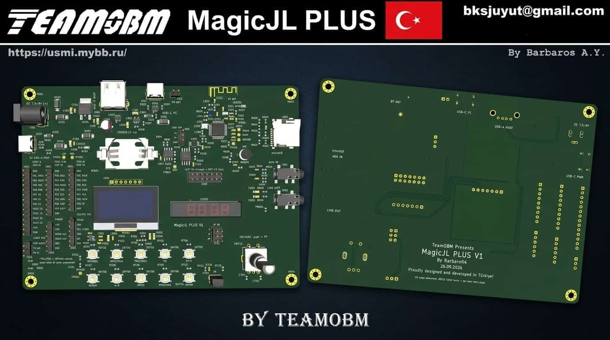
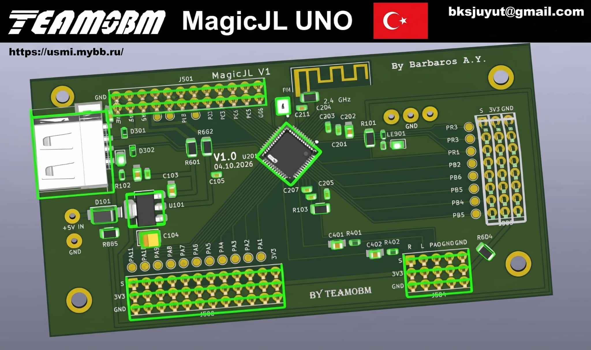

# BARBAROR4

<p align="center">
  <b>Embedded Systems • Firmware Development • Reverse Engineering • Audio DSP</b>
  <br><br>
  
  
  
  
</p>

```console
barbaror4@bench:~$ whoami
```

Electronics enthusiast focused on embedded development, firmware analysis, and audio hardware. I enjoy exploring obscure SoCs, understanding undocumented systems, and pushing inexpensive hardware beyond its original capabilities.

## ./hardware

<p align="center">
  
  
  
  
</p>

Working with STM32F103, STM32F411, and STM32F746 platforms, alongside ESP32/ESP8266. My primary focus is JieLi audio SoCs, custom firmware, and hardware design.

## ./projects

### [MagicJieLi — MagicJL](https://github.com/OmfoBalkanMicroElectronics/MagicJieLi)

**My main area of development:** custom firmware and hardware projects built around JieLi AC692x audio SoCs.

- **MagicJL Color** — custom firmware development for AC692x-based devices.
- **MagicJL Plus** — feature-rich firmware with expanded functionality.
- 
- **MagicJL UNO** — custom Arduino UNO sized PCB design for JieLi-based development.
 <p align="center">
  
 </p>
 
- **MagicJL PLUS** — a further custom hardware design for the MagicJL platform.
- <p align="center">
  
  </p>
The goal is to explore the capabilities of JieLi platforms beyond their original implementations through firmware development, reverse engineering, and custom hardware.

### [MAGICEMU](https://github.com/Barbaror4/MAGICEMU)

Retro emulation and multimedia on the STM32F746G-DISCO.

- NES emulation, DOOM, and Wolfenstein 3D
- Audio and multimedia features
- Display, storage, and peripheral integration

### [Linux on STM32F7-DISCO](https://github.com/Barbaror4/linux-stm32f7-disco)

A Linux 2.6.33 uClinux/NOMMU port for the STM32F746G-DISCO, exploring embedded Linux on a Cortex-M7 platform without an MMU.

## ./interests

- JieLi AC692x firmware and SDK development
- Firmware reverse engineering and undocumented SoCs
- Custom PCB design and embedded hardware
- Embedded audio, USB Audio, and DSP
- STM32 peripherals, DMA, and real-time systems
- Audio codecs, DACs, FFT, and parametric EQ

## ./tools

**IDEs:** Code::Blocks · STM32CubeIDE · VS Code

**Hardware:** Multimeter · CH341A · USB-UART adapters

**Debugging:** UART logs · Firmware dumps · Software diagnostics

## ./philosophy

I work with the tools and hardware I have, learning through datasheets, source code, experimentation, and reverse engineering.

> Expensive ≠ Interesting  
> Old ≠ Useless  
> Cheap ≠ Simple

**Understand it. Modify it. Push it further.**

<p align="center">
  
  <br>
  
  <br><br>
  <i>Hardware is more fun when you dig deeper.</i>
</p>****
